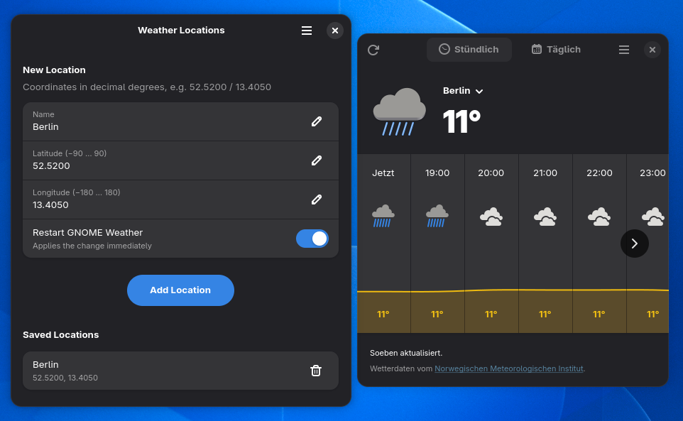

# 🌤️ gweather-add-loc

Add custom locations with arbitrary coordinates to **GNOME Weather** (`org.gnome.Weather`) via `gsettings`.

Works with both **native packages** and **Flatpak** installations on **GNOME 40+ / libgweather-4**.



Two tools are included:

| Tool | What it is |
| --- | --- |
| 🖥️ **GTK app** (`gweather-add-loc`) | GTK4/libadwaita app written in Rust: add, list and remove locations |
| 📜 **Bash script** (`gweather-add-loc.sh`) | Simple standalone script to add a location from the terminal |

> 📍 **Coordinates:** always enter **latitude first, then longitude** (e.g. Berlin: `52.5200` / `13.4050`). Swapped values place the location somewhere else on the globe and the weather will be wrong.

## ✨ Features

* Automatically detects **Flatpak** vs. **native package** installations
* Converts decimal degrees to radians with proper leading-zero formatting
* Formats and injects the exact `libgweather-4` GVariant data structure
* Gracefully restarts GNOME Weather to apply changes immediately

The GTK app additionally lets you:

* See all saved locations and **remove** them
* New locations are added at the top of the list and become the current location
* Enter coordinates with `.` or `,` as decimal separator
* Choose whether GNOME Weather should be restarted after a change

## 🖥️ GTK app

### Requirements

* GTK 4 and libadwaita **>= 1.4**
* glibc **>= 2.39** (for the prebuilt binary, which is built on Ubuntu 24.04)

### Install a prebuilt binary

Download `gweather-add-loc-<version>-x86_64-linux.tar.gz` from the [Releases](https://github.com/crian/gweather-add-loc/releases) page, extract it and run:

```bash
make install-files BINPATH=./gweather-add-loc
```

This installs the binary, the menu entry and the icons to `~/.local`. Use `PREFIX=/usr/local` (with `sudo`) for a system-wide install. You can also just run `./gweather-add-loc` without installing.

### Build from source

Build dependencies: a Rust toolchain (`cargo`) and the GTK 4 / libadwaita development files.

* **Debian/Ubuntu:** `sudo apt install cargo libgtk-4-dev libadwaita-1-dev`
* **Fedora:** `sudo dnf install cargo gtk4-devel libadwaita-devel`

```bash
git clone https://github.com/crian/gweather-add-loc.git
cd gweather-add-loc
make
make install
```

Make sure `~/.local/bin` is in your `PATH`. The app then appears in the application menu as **Weather Locations**, or run `gweather-add-loc`. Remove it again with `make uninstall`.

## 📜 Bash script

### 🚀 Installation

Clone the repository:

```bash
git clone https://github.com/crian/gweather-add-loc.git
cd gweather-add-loc
```

### ⚙️ Usage

```bash
./gweather-add-loc.sh [--no-restart] "Location Name" LATITUDE LONGITUDE
```

Latitude comes first. `.` and `,` both work as decimal separator.

By default the new location is put at the **top** of the list, so GNOME Weather uses it as the current location. Use `--no-restart` to skip restarting GNOME Weather.

#### 💡 Example

Add Berlin:
```bash
./gweather-add-loc.sh "Berlin" 52.5200 13.4050
```

The script validates the input, automatically converts the coordinates to radians, formats the `libgweather-4` GVariant string, updates `gsettings`, and restarts `gnome-weather` to apply the changes.

## 📄 License

MIT
